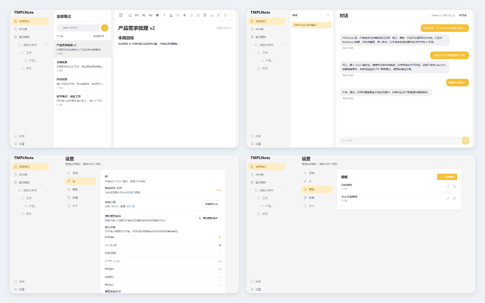
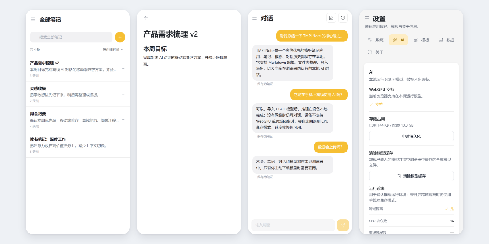

# TMPLNote

**带模板与本地 AI 的离线优先笔记应用（PWA）**

在线体验：**<https://tmplnote.pages.dev/>**

---

  

  桌面端：笔记、AI 对话、AI 设置与模板

  

  移动端：笔记列表、编辑器、AI 对话与 AI 设置

## 亮点

- **离线优先**：笔记、模板、对话历史与模型全部保存在本地，断网仍可使用。
- **本地 AI**：基于 wllama + GGUF，优先使用 WebGPU；不可用时自动回退到 CPU 兼容模式。
- **移动端可用**：没有 WebGPU 或未开启跨域隔离时，仍可单线程推理；Safari / iOS 会尝试通过 `require-corp` 进入跨域隔离。
- **Safari 兼容构建**：iOS / Safari / Firefox 使用本地打包的 wllama compat wasm（约 16MB），避免 Safari 的 JIT / MEMORY64 限制；兼容资源随 PWA 预缓存，仍可离线。
- **iOS 低内存兼容**：Low 模式在 iOS 上强制单线程，避免共享内存分配失败；仍失败时会自动尝试极低内存模式（上下文最多 2048）。如果极低内存模式仍失败，说明模型超出设备内存，建议使用更小模型。
- **模板笔记**：两级文件夹、置顶、搜索、最近删除，支持模板创建与复用。
- **对话助手**：流式回复、思考链、工具调用、写操作授权，可一键保存为笔记。
- **导入导出**：支持 Markdown / 纯文本 / Word 的 ZIP 导出，以及选择性导入。
- **百度网盘自动备份与双向同步**：手动加密存档、可选自动加密备份与双向同步；完整备份先在本地用口令加密再上传，多设备冲突会保存为副本，删除可传播。
- **PWA**：可安装到桌面或主屏幕，Service Worker 预缓存应用壳，离线可用。
- **隐私**：数据不上传服务器，AI 推理完全在本地完成。

## 功能说明

### 笔记与模板

- Markdown 富文本编辑，支持标题、列表、引用、代码块、表格等常用格式。
- 两级文件夹管理，支持未分类、置顶、搜索、最近删除。
- 模板独立管理，新建笔记时可复用模板内容。

### 本地 AI 对话

- 在浏览器内加载 GGUF 模型，对话内容不离开设备。
- 优先 WebGPU 加速；载入失败时自动尝试 CPU 均衡 / 低功耗模式。
- 支持流式回复、思考链、工具调用与中止生成。
- AI 可读取本地笔记；新建笔记等写操作会先弹出授权确认。
- 移动端无跨域隔离时自动使用 CPU 兼容模式，速度较慢但可用。
- iOS 的 Low 模式强制单线程；载入失败会继续尝试 2048 上下文的极低内存模式。
- Safari / iOS 使用本地 compat 构建；首次加载会额外缓存约 16MB 的 compat wasm，速度低于 Chromium 的常规构建。

### 导入导出

- 导出为 Markdown / 纯文本 / Word 的 ZIP 压缩包。
- 支持按笔记、文件夹、模板选择性导出。
- 支持导入 TMPLNote 导出的数据包，便于备份与迁移。

### 百度网盘自动备份与双向同步

- 在 **设置 → 网盘** 粘贴百度网盘 `access_token`，填写应用目录与桥接地址后点击“验证并保存”，完成连接验证后自动功能才可启用。
- **手动存档**：上传内容为完整备份 JSON，先在浏览器本地用口令加密，再上传为 `.tmplenc` 文件；支持列出、下载解密恢复与删除，恢复时可选择合并或覆盖。手动上传的口令不会保存，忘记后无法解密。
- **自动备份**：完成连接验证后启用，设置至少 8 位的自动同步口令；本地变更防抖 90 秒、按固定周期（默认 30 分钟）、应用启动、联网或回到前台时自动导出、加密并上传。
- 自动运行还会检查：在线、页面可见、访问锁未锁定、自动口令已解锁、没有进行中的任务、最近 30 秒无键盘/指针输入、距上次自动运行至少 60 秒；不满足时自动顺延。
- 自动备份文件名前缀为 `tmplnote-auto-`（形如 `tmplnote-auto-YYYYMMDD-HHmmss-<设备标识>-<随机串>.tmplenc`）。保留份数默认 7 份，只清理自动备份，不会删除手动上传的 `tmplnote-archive-*`；自动备份同样可通过“下载并恢复”解密。
- **双向同步**：云端以最新一份自动备份作为远端状态，流程为「列出 → 下载解密 → 本地/远端/base 三方合并 → 单事务写库 → 上传合并结果」。新增、修改、删除、移动都会传播；同一笔记两侧都修改时保留较新记录，并把较旧内容保存为「冲突副本」；删除与编辑冲突时保留编辑内容；远端删除在本地进入最近删除，不会物理删除；文件夹删除后笔记归入未分类。
- **自动口令保存**：可选择“在本机加密保存口令”，口令由不可导出的设备密钥加密后存入本机 IndexedDB `secrets`，以支持无人值守自动备份；浏览器不支持安全保存时只能选择“仅本次会话”，每次打开应用后需重新解锁。手动上传口令始终不保存。
- 加密使用 PBKDF2-SHA-256（310000 次）+ AES-GCM-256；云端只保存密文。若云端自动备份全部被手动删除，下次同步会以本地数据为准重建基线，不会误删本地笔记。
- 上传采用百度网盘官方推荐的「预上传 → 4 MB 分片上传 → 创建文件」流程，避免单步上传的接口能力限制；单个存档上传 / 下载限制 50 MB。
- 存档只能保存在 `/apps/{百度应用产品名}` 目录下；`access_token` 约 30 天过期，过期后需重新获取并粘贴。
- 已知限制：双向同步以最新一份自动备份为远端状态，两台设备在同一时间窗口并发上传时可能需要下一轮才能收敛；同步仅覆盖笔记与文件夹，AI 对话、模型与 token 不同步；自动备份是完整快照，数据量很大时上传会较慢。

#### 桥接服务

百度网盘 OpenAPI 不返回 CORS 头，且下载要求 `User-Agent: pan.baidu.com`，浏览器无法直连。
本项目提供同源桥接层：

- **Cloudflare Pages**：`functions/api/baidu.js` 自动生效，默认地址 `/api/baidu`。
- **GitHub Pages 等纯静态部署**：需自行部署同逻辑的 Worker，并在设置页填写完整桥接地址。
- **本地开发**：`npm run dev` 内置 `/api/baidu` 中间件，可直接联调上传与下载。

桥接层只允许转发到 `pan.baidu.com`、`pcs.baidu.com`、`*.baidupcs.com`，不记录 token。

> 自动备份、双向同步、恢复流程与安全模型的完整说明见 [docs/baidu-sync.md](./docs/baidu-sync.md)。

### 离线与安装

- 首次在线打开后，Service Worker 会预缓存应用壳与推理引擎。
- 模型导入后保存在本地 Cache Storage，之后可离线对话。
- 可通过浏览器“安装应用”添加到桌面或主屏幕。

### 数据与隐私

- 笔记、文件夹与设置保存在 IndexedDB。
- 对话历史保存在独立 IndexedDB。
- 本地模型权重保存在 Cache Storage。
- 百度网盘 `access_token` 仅保存在本机 IndexedDB，不进入备份，也不会写入云端文件。
- 云端存档（手动与自动）始终是口令加密后的密文，使用 PBKDF2-SHA-256（310000 次）+ AES-GCM-256 加密。
- 自动同步口令可选“在本机加密保存”：口令由不可导出的设备密钥加密后存入本机 IndexedDB `secrets`；手动上传口令不会保存。口令遗失后无法解密云端存档。
- 双向同步产生的冲突副本保存在本机笔记库中；它们不会单独上传，但会随下一次自动备份 / 同步一起加密进入备份。
- 同步只处理笔记与文件夹；AI 对话、模型与 token 不会进入备份或同步。
- 除你主动启用的百度网盘备份 / 同步外，数据默认只保存在本机浏览器，不上传服务器。

## 使用本地 AI

1. 打开 **设置 → AI**。
2. 点击复制模型下载链接，在浏览器中下载 GGUF 模型；也可以直接导入已有的本地模型文件。
3. 回到应用，选择文件导入并载入模型。移动端建议使用 Q4_0 量化。
4. 进入 **对话** 页面开始使用；模型缓存后，断网也能继续对话。

> 模型首次使用需要联网下载（数百 MB）。下载并导入后保存在本地，后续可离线使用。

## 使用百度网盘自动备份与双向同步

1. 在百度网盘开放平台创建应用，开通上传权限，并确认应用目录为 `/apps/{产品名}`。
2. 通过百度 OAuth 简化模式获取 `scope=basic,netdisk` 的 `access_token`。
3. 打开 **设置 → 网盘**，粘贴 token、填写应用目录与桥接地址，点击“验证并保存”，先完成连接验证。
4. 点击“启用自动备份…”，设置至少 8 位自动同步口令；按需选择是否在本机加密保存口令、自动备份周期与保留份数。如需多设备同步，在同一弹窗中开启“双向同步（多设备）”；也可以先只启用自动备份。
5. 启用后可用“立即备份 / 立即同步”手动触发一次。开启双向同步后按钮变为“立即同步”，会下载云端最新自动备份并与本机合并。
6. 同一笔记两侧都修改时会生成“冲突副本”，可在笔记列表查看；需要恢复历史数据时，选择云端存档点击“下载并恢复”，输入口令后选择合并或覆盖。
7. 自动备份按周期与保留份数轮换；手动上传的存档不会被自动清理。

> 手动上传的口令不会保存，也无法找回；自动模式可选择在本机加密保存口令，但口令遗失后云端存档仍无法解密。
>
> 自动同步 / 备份依赖同源桥接服务与百度网盘应用目录权限，需先完成连接验证；存档只能访问 `/apps/{应用产品名}` 下的文件。
>
> 完整配置、自动备份机制、双向同步、安全模型与常见问题见 [docs/baidu-sync.md](./docs/baidu-sync.md)。

## 许可协议

本项目采用**个人免费使用、禁止商用**的授权方式：

- **允许**：个人学习、研究与自用。
- **禁止**：任何形式的商业用途。
- **商业授权**：如需将本项目用于商业场景，须事先获得作者书面授权。

本仓库不附带独立的 `LICENSE` 文件；以上说明即为本项目的许可声明。
