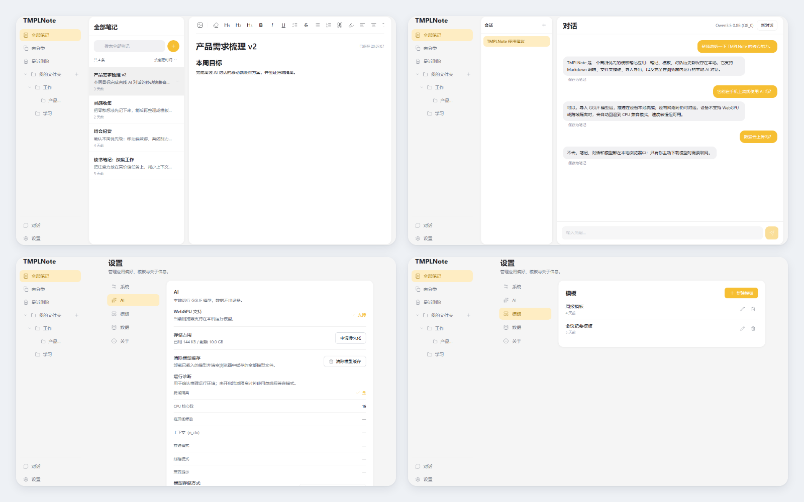
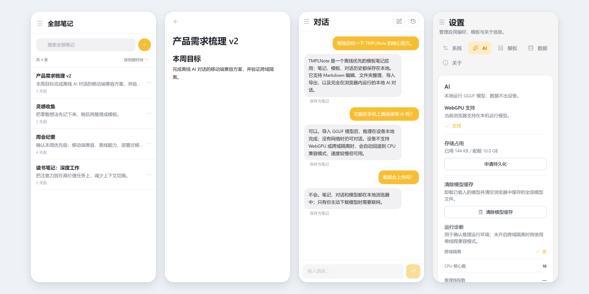

# TMPLNote

**带模板与本地 AI 的离线优先笔记应用（PWA）**

在线体验：**<https://tmplnote.pages.dev/>**

---

  

  桌面端：笔记、AI 对话、AI 设置与模板

  

  移动端：笔记列表、编辑器、AI 对话与 AI 设置

## 亮点

- **离线优先**：笔记、模板、对话历史与模型全部保存在本地，断网仍可使用。
- **本地 AI**：基于 wllama + GGUF，优先使用 WebGPU；不可用时自动回退到 CPU 兼容模式。
- **移动端可用**：没有 WebGPU 或未开启跨域隔离时，仍可单线程推理；Safari / iOS 会尝试通过 `require-corp` 进入跨域隔离。
- **模板笔记**：两级文件夹、置顶、搜索、最近删除，支持模板创建与复用。
- **对话助手**：流式回复、思考链、工具调用、写操作授权，可一键保存为笔记。
- **导入导出**：支持 Markdown / 纯文本 / Word 的 ZIP 导出，以及选择性导入。
- **PWA**：可安装到桌面或主屏幕，Service Worker 预缓存应用壳，离线可用。
- **隐私**：数据不上传服务器，AI 推理完全在本地完成。

## 功能说明

### 笔记与模板

- Markdown 富文本编辑，支持标题、列表、引用、代码块、表格等常用格式。
- 两级文件夹管理，支持未分类、置顶、搜索、最近删除。
- 模板独立管理，新建笔记时可复用模板内容。

### 本地 AI 对话

- 在浏览器内加载 GGUF 模型，对话内容不离开设备。
- 优先 WebGPU 加速；载入失败时自动尝试 CPU 均衡 / 低功耗模式。
- 支持流式回复、思考链、工具调用与中止生成。
- AI 可读取本地笔记；新建笔记等写操作会先弹出授权确认。
- 移动端无跨域隔离时自动使用 CPU 兼容模式，速度较慢但可用。

### 导入导出

- 导出为 Markdown / 纯文本 / Word 的 ZIP 压缩包。
- 支持按笔记、文件夹、模板选择性导出。
- 支持导入 TMPLNote 导出的数据包，便于备份与迁移。

### 离线与安装

- 首次在线打开后，Service Worker 会预缓存应用壳与推理引擎。
- 模型导入后保存在本地 Cache Storage，之后可离线对话。
- 可通过浏览器“安装应用”添加到桌面或主屏幕。

### 数据与隐私

- 笔记、文件夹与设置保存在 IndexedDB。
- 对话历史保存在独立 IndexedDB。
- 本地模型权重保存在 Cache Storage。
- 所有数据默认只保存在本机浏览器，不上传服务器。

## 使用本地 AI

1. 打开 **设置 → AI**。
2. 点击复制模型下载链接，在浏览器中下载 GGUF 模型；也可以直接导入已有的本地模型文件。
3. 回到应用，选择文件导入并载入模型。移动端建议使用 Q4_0 量化。
4. 进入 **对话** 页面开始使用；模型缓存后，断网也能继续对话。

> 模型首次使用需要联网下载（数百 MB）。下载并导入后保存在本地，后续可离线使用。

## 许可协议

本项目采用**个人免费使用、禁止商用**的授权方式：

- **允许**：个人学习、研究与自用。
- **禁止**：任何形式的商业用途。
- **商业授权**：如需将本项目用于商业场景，须事先获得作者书面授权。

本仓库不附带独立的 `LICENSE` 文件；以上说明即为本项目的许可声明。
